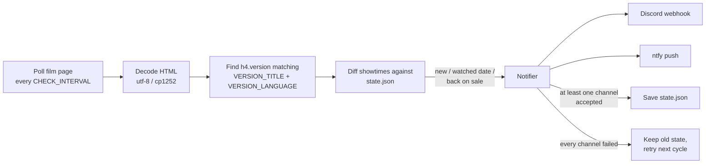

# I need IMAX Seats (╯°□°)╯︵ ┻━┻

A small self-hosted watcher that pings Discord and/or your phone (ntfy) the
moment a [Traumpalast](https://leonberg.traumpalast.de/) cinema publishes new
showtimes for **one specific screening version**, by default German-language IMAX.

[](https://github.com/xD33m/imax-seats/actions/workflows/ci.yml)
[](LICENSE)
[](https://github.com/xD33m/imax-seats/pkgs/container/imax-seats)

## Why it exists

The cinema publishes the next two weeks of showtimes in batches, usually on
Mondays, and a film page mixes several versions (`Standardfassung`, `IMAX`,
`Originalversion`, `IMAX (Originalversion)`, ...). Refreshing that page by hand
to catch the one version and the few dates you care about is tedious. This
watcher polls the page, compares the showtimes of exactly that version with the
ones it has already seen, and posts only the difference.

## What an alert looks like

New showtimes (each time links straight to its ticket page):

```
🎬 Die Odyssee — 5 new IMAX (Deutsch) showtimes!
https://leonberg.traumpalast.de/index.php/FN/8415/PID/5574.html
So, 09.08. — 14:30
Mo, 10.08. — 19:00
Di, 11.08. — 14:30
Mi, 12.08. — 14:30 · 19:00
```

A date you are trying to book (`WATCH_DATES`) gets its own alert, with a
`MENTION` prefix so your phone pushes even if the channel is set to
*Only @mentions*:

```
@everyone 🎯 Die Odyssee is now bookable on Sa, 22.08, So, 23.08 (IMAX (Deutsch))!
🎯 Sa, 22.08. — 14:30 · 19:00
🎯 So, 23.08. — 10:00 · 19:00
```

## Features

- **Exact version matching.** The `<h4 class="version">` heading is matched on
  title *and* language line, so `VERSION_TITLE=IMAX` never picks up
  `IMAX (Originalversion)`.
- **Only the diff.** Showtimes are keyed by start time and persisted to a state
  file, so restarts and changed ticket IDs do not cause duplicate alerts.
- **Watched dates.** A watched date is announced the first time it appears on
  the page at all, not only when a showtime is "new". Adding a date later still
  alerts you, and a date that is pulled and re-published alerts again.
- **Two channels.** Discord webhook and [ntfy](https://ntfy.sh/) push, usable
  together. Watched-date alerts go to ntfy at max priority and tap through to a
  ticket page.
- **Back on sale.** Optionally reports a sold-out screening becoming bookable
  again.
- **Failure handling.** HTTP retries with timeouts, capped exponential backoff,
  one warning per outage plus a recovery message, atomic state writes, and
  SIGTERM handling.
- **Container-ready.** Non-root image for `linux/amd64` and `linux/arm64`
  (e.g. a Raspberry Pi), with a healthcheck based on a liveness file.

## Quick start (Docker Compose)

```bash
git clone https://github.com/xD33m/imax-seats.git
cd imax-seats
cp .env.example .env   # then fill in TARGET_URL and DISCORD_WEBHOOK_URL and/or NTFY_TOPIC
```

`TARGET_URL` is the film page you want to watch: open the film on the
Traumpalast site and copy the URL. `DISCORD_WEBHOOK_URL` comes from your Discord
channel under *Settings → Integrations → Webhooks → New Webhook*.

The container runs as UID `10001` and keeps its state in `./data`. On Linux,
create that directory with the right owner first:

```bash
mkdir -p data && sudo chown 10001:10001 data
```

Check that it sees the right showtimes, verify your channels, then start it:

```bash
docker compose run --rm notifier python notifier.py --show          # print showtimes, no messages
docker compose run --rm notifier python notifier.py --test-notify   # one test message per channel
docker compose up -d
docker compose logs -f
```

`docker compose up -d` pulls the prebuilt image `ghcr.io/xd33m/imax-seats:latest`.
To build from source instead, run `docker compose up -d --build`.

### Without Docker

```bash
pip install -r requirements.txt
cp .env.example .env
python notifier.py --show   # compare against the row on the website
python notifier.py
```

## Getting it onto your phone

An alert counts as delivered if at least one channel accepts it, so a broken
channel never blocks or duplicates the other.

**Discord** (`DISCORD_WEBHOOK_URL`) works if the channel is set to *All
Messages*; if it is on *Only @mentions*, set `MENTION=@everyone` so watched-date
alerts still push.

**ntfy** (`NTFY_TOPIC`) needs no account: install the [ntfy app](https://ntfy.sh/),
subscribe to a topic, and put that topic in `.env`. Watched-date alerts go out
at max priority (audible through Do Not Disturb on Android) and tapping the
notification opens the ticket page directly. Topics are **public to anyone who
knows the name**, so use a long random one such as `imax-seats-<random>`.

## Configuration

Everything is set through the environment (or `.env`). `TARGET_URL` plus at
least one channel is required; see [.env.example](.env.example) for the full
list.

| Variable | Default | Meaning |
| --- | --- | --- |
| `TARGET_URL` | — | Film page to watch |
| `DISCORD_WEBHOOK_URL` | — | Discord webhook to post to |
| `NTFY_TOPIC` | — | ntfy topic to push to (enables the ntfy channel) |
| `NTFY_SERVER` | `https://ntfy.sh` | ntfy server, if you self-host |
| `NTFY_TOKEN` | — | Bearer token, for a protected ntfy topic |
| `VERSION_TITLE` | `IMAX` | Version heading to match, exactly |
| `VERSION_LANGUAGE` | `Deutsch` | Language line under the heading (empty = ignore) |
| `WATCH_DATES` | — | Dates that get their own alert, e.g. `16.08.2026,22.08.2026` |
| `MENTION` | — | Prefix for watched-date alerts, e.g. `@everyone` |
| `CHECK_INTERVAL` | `120` | Seconds between checks (minimum 15) |
| `STATE_FILE` | `state.json` | Where already-announced showtimes are stored |
| `HEALTH_FILE` | — | Touched after each successful check, for the Docker healthcheck |
| `NOTIFY_ON_START` | `true` | Post a summary of what is listed on startup |
| `NOTIFY_SOLD_OUT_CHANGES` | `true` | Also report showtimes going back on sale |
| `FAILURE_ALERT_AFTER` | `3` | Consecutive failures before a warning is posted |
| `MAX_BACKOFF` | `1800` | Cap for the backoff after failures, in seconds |
| `REQUEST_TIMEOUT` | `20` | HTTP timeout in seconds |
| `HTTP_RETRIES` | `3` | Retries per HTTP request |
| `HEARTBEAT_HOURS` | `0` | "Still alive" message every N hours (0 = off) |

The Docker image sets `STATE_FILE=/data/state.json` and `HEALTH_FILE=/data/health`.

To watch the English IMAX version instead:

```
VERSION_TITLE=IMAX (Originalversion)
VERSION_LANGUAGE=Originalsprache
```

### Command line

```
python notifier.py                 # run the watcher
python notifier.py --show          # print the current showtimes and exit
python notifier.py --test-notify   # send one test message to every channel
python notifier.py --once          # single check, then exit (for cron)
python notifier.py --dry-run       # log what would be posted, post nothing
python notifier.py --verbose       # debug logging
```

`--once` exits non-zero when the check fails, so it works as a cron job:

```
*/5 * * * * cd /opt/imax-seats && python notifier.py --once >> watch.log 2>&1
```

## How it works



After every successful check the watcher touches `HEALTH_FILE`; the Docker
healthcheck marks the container unhealthy once that file is older than five
polling intervals.

Everything lives in a single module, [`notifier.py`](notifier.py):
`parse_page` extracts the showings of the configured version, `diff` compares
them with the persisted `State`, and `Watcher.check` decides which alerts to send
through `Notifier`, which fans out to the `DiscordChannel` and `NtfyChannel`.

## Behaviour and trade-offs

- **Failures do not lose alerts.** If no channel accepts a message, the state
  file is not advanced, so the same showtimes are reported on the next check.
- **Backoff.** Repeated failures back off exponentially up to `MAX_BACKOFF`, and
  only one warning is posted per outage, followed by a recovery message.
- **Encoding.** The Traumpalast server declares `charset=utf-8` but actually
  sends cp1252; the page is decoded defensively rather than trusting either.
- **Missing version.** If the version disappears from the page (e.g. the film
  stops running in IMAX), that is logged once and nothing is announced.
- **Tied to one site's markup.** Parsing relies on Traumpalast's
  `h4.version` / `.day-time` / `<time datetime>` structure. A redesign of the
  site will break it; the test fixture makes such a break easy to spot.
- **Polling, not push.** The cinema offers no feed, so the watcher polls. Keep
  `CHECK_INTERVAL` reasonable (default 120 s) to stay polite to the site.
- **One film and one version per instance.** Run several containers with
  different `.env` files and state directories to watch more.
- **Seat availability is coarse.** The watcher only knows what the film page
  shows (a showtime is bookable or sold out), not individual seats.

## Tests

```bash
pip install -r requirements-dev.txt
ruff check .
pytest
```

The suite parses a saved copy of a real film page and runs the watcher against a
local HTTP server that impersonates both the cinema and Discord, including the
Monday case where a second week of showtimes appears. CI runs lint and tests on
every push and pull request, then builds the multi-arch image and publishes it to
GHCR from `main` and from `v*` tags.

## How this was built

The first version (2023) was a simple page-hash checker. The 2026 rewrite into
the version-aware watcher described here was developed with an AI coding
assistant (Claude). The author reviewed the changes, and the behaviour is covered
by the test suite in this repository.

## License

[MIT](LICENSE)
